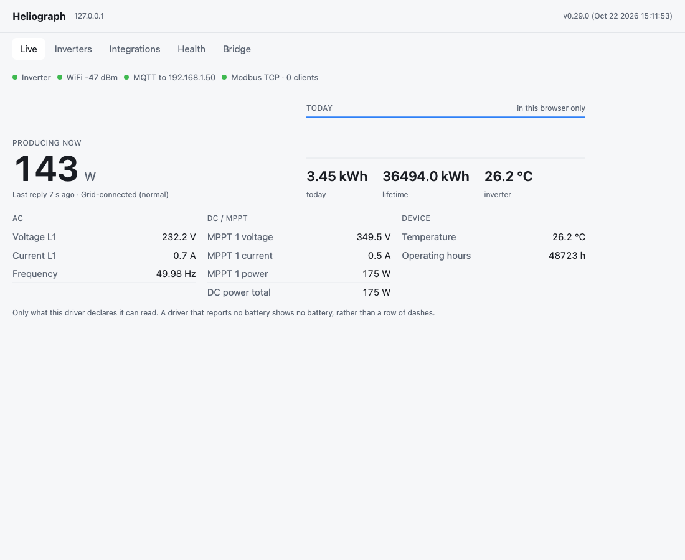
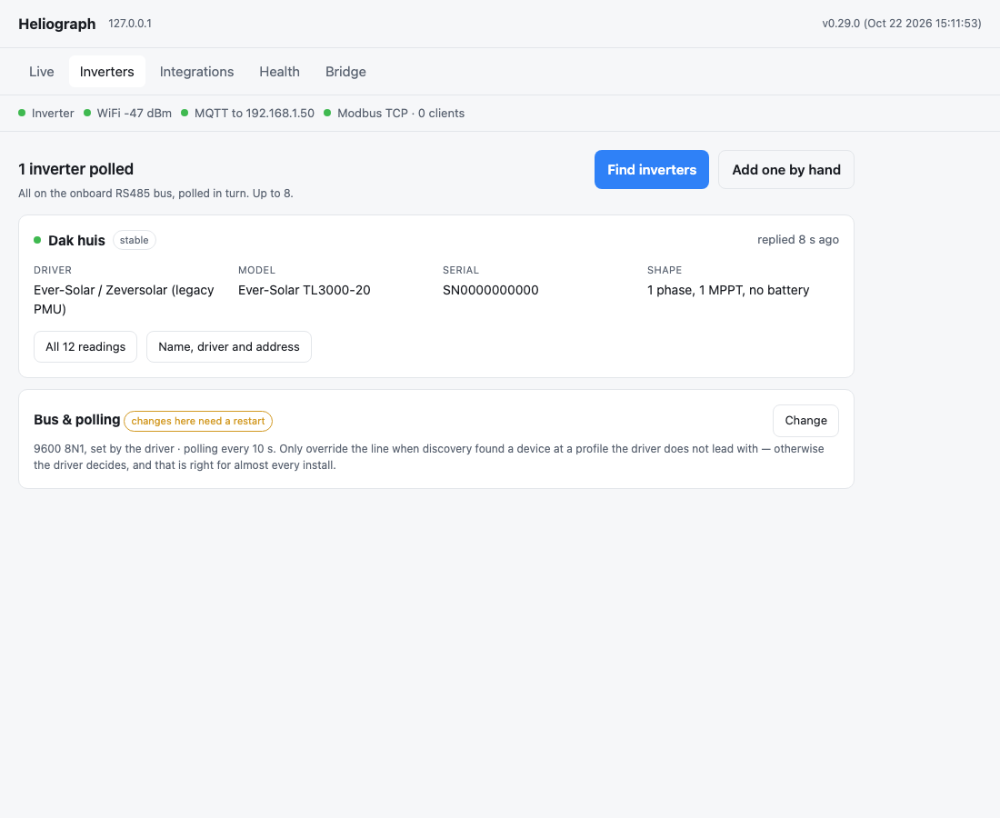
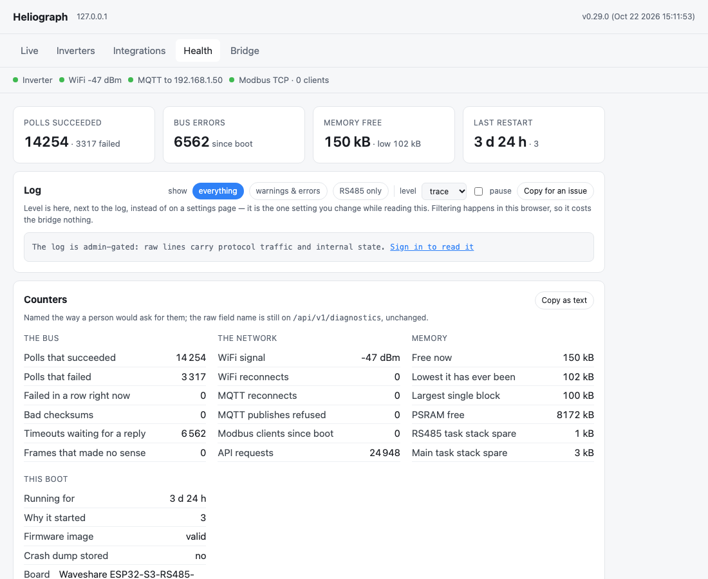

# Heliograph

**Read your solar inverter over RS485 and publish it locally — Home Assistant, MQTT, Modbus TCP,
REST and Prometheus, all at once. One ESP32 board, roughly €20–30, no cloud anywhere in the
path.**

> **Before anything else, check [the inverter table](#does-it-work-with-my-inverter).** Most of
> it says *never met a device*. That is not modesty — it is the only number on this page that
> decides whether this is worth your evening.

---

## Why it exists

The portal was shut down, the app stopped working, or the dongle is no longer supported. The
inverter still produces perfectly; you just cannot see it any more. Heliograph exists because of
an EverSolar that outlived its own monitoring portal.

Reading the inverter over its own RS485 port removes the vendor from the path: no account, no
portal, no dongle firmware that can decide to stop answering. **It does not make you immune to a
vendor changing what that port does.** Nothing can promise that, and anyone who does is guessing.

Four things people keep running into, and where this lands on each:

| What happens | Where this helps |
|---|---|
| A firmware update quietly removes local access. Reported on Solax, SolarEdge, Huawei, Deye, Solarman sticks, APsystems, Enphase. | RS485 is a different door from the dongle or the API. If the vendor closes that door too, this stops working as well. |
| The cloud is slow, rate-limited, or locks you out. One Growatt owner: *"I have been banned for 24 hours."* | No account to ban. Polls every 10 s by default. |
| The vendor disappears. Omnik went bankrupt; `solaredge_modbus` was archived in May 2026 with no successor. | MIT, self-hosted, no server to switch off. |
| Readings are silently wrong, and nobody can tell you whether the register map is right. | Every map says how far it has been proven. See below. |

---

## What it does

Reads the inverter over RS485 and serves the same decoded data four ways at the same time:
**MQTT** with Home Assistant discovery, a **Modbus TCP server**, a **REST API**, and
**Prometheus**. It has its own dashboard on the board, so there is nothing else to install to
see whether it works.

Polling is **every 10 seconds by default**, configurable from 1 to 3600. A poll takes about
103 ms. That is faster than a cloud that lags five to fifteen minutes, and it is still a poll
and not a live feed.

It speaks more than one wire protocol, which is unusual on an ESP32. Two of them are not Modbus
at all — EverSolar/Zeversolar's own PMU framing, and SolarMax's MaxTalk ASCII. Alongside those it
reads SunSpec and plain Modbus RTU with eleven device profiles. A discovery mode probes an
unknown RS485 bus and works out which family is on it.

---

## Does it work with my inverter?

Probably not yet, and nobody should tell you otherwise from a README.

This table does not count how many inverters are *supported*. It counts how many have been seen
working, which is two.

An inverter is reached in one of two ways. A **driver** is hand-written code for one protocol
family. A **profile** is a Modbus register map written as data — a table of addresses, scales and
units — read by the one Modbus driver. The two are graded separately, because they fail
differently: a driver gets the framing wrong, a profile gets the meaning of register 33079 wrong.

**Drivers**

| Driver | Status | Has a real device ever answered it? |
|---|---|---|
| EverSolar / Zeversolar **TL** series (PMU framing, not Modbus) | **Stable**, for that model | Yes — a TL3000-20, the author's own, in production |
| Same driver, Zeversolar **TLC** series (three-phase) | **Beta** | Yes — one TLC8000, on a contributor's hardware, not the author's |
| SunSpec | Experimental | No |
| SolarMax (MaxTalk ASCII, not Modbus) | Experimental | No |
| SolaX X1 | Experimental | One field attempt. It returned zero bytes. |

**Modbus profiles** — Deye, GoodWe, Growatt (×3), Huawei, Sofar (×2), Solis (×2), Sungrow

| | |
|---|---|
| Status | Experimental, all eleven |
| Have any of them met a device? | **No. Zero of eleven.** |

Those eleven are where most inverter brands live, and they are the part of this project with the
least evidence behind it. The two inverters that have answered are both EverSolar, through the
driver in the first table.

**Experimental** means implemented from documentation. It may simply not work. If you run it,
you are the first.
**Beta** means a real inverter has answered it, and it has not yet run unattended long enough to
be called anything more.
**Stable** means validated and soak-tested on hardware. The label belongs to a driver *and* an
inverter, not to a driver alone.

What Experimental looks like in practice: the one outside tester who reported back had a
three-phase Deye SG05, and the bundled profile returned no readings until he wrote his own
driver.

### How a register map earns its grade

A map copied out of a vendor PDF is not a map a device has answered. Vendor documentation is
sometimes only partly accurate, and a reading that is valid but wrong is the failure that goes
unnoticed for months.

So each profile records where every row came from, and is graded by how many independent sources
agree on it. Two agreeing sources is still not a device confirming — it is a better guess, and it
is labelled as one. Eleven profiles, 197 read registers, 8 write rows, nothing verified against
hardware. [`docs/drivers/coverage.md`](docs/drivers/coverage.md) has it row by row.

No inverter firmware version is named as tested anywhere in this project. Do not read that
absence as "all of them".

---

## Who this is for

- You have an inverter with an RS485 port, and a vendor cloud you would rather not depend on.
- You run Home Assistant, Prometheus, or something that speaks Modbus TCP.
- You can live with a project where your inverter has probably never been tried.

## Who it is not for

- Anyone whose inverter has no RS485 connection. Some are WiFi-only, and there is nothing here
  for them.
- Anyone who needs a control path they can rely on today. See below.
- Anyone who needs authentication on the data outputs.

---

## Where it stops

- **Eleven of eleven Modbus profiles have never met a device.** Nor has SunSpec, nor SolarMax.
- **DRM curtailment has never driven a real inverter.** The relay boards are measured on the
  bench — order, polarity, failsafe, boot state. The inverter side of that connection has never
  been made. If you are the first, [`docs/drm.md`](docs/drm.md) is written for you, and expect to
  debug it.
- **Writes are switched off, not absent.** `security.read_only_mode` is on by default and refuses
  every command before a driver is reached. That flag is the guarantee. The SunSpec driver does
  carry a write path for the power limit and for connect/disconnect, and no device has ever
  answered it. [`docs/security.md`](docs/security.md) is the authority.
- **Modbus TCP carries 39 of the 44 channels.** `battery.power`, `battery.current`,
  `battery.temperature` and both battery energy counters have no register.
- **No authentication on Modbus TCP or on REST reads.** Where there is authentication it is HTTP
  Basic over plain HTTP, and OTA images are unsigned. Keep it on a network you trust.
- **A wrong-but-valid static IP can lock you out** ([#69](https://github.com/Timdebruijn/heliograph/issues/69)).
  Holding BOOT to factory-reset is the only way back.
- **One maintainer, pre-1.0.** Expect breaking changes.

---

## What else exists

If you have a Raspberry Pi, [SolarAssistant](https://solar-assistant.io) covers 66 vendors across
RS232, RS485 and CAN, with a cable per protocol. It costs €59 software-only, or €159–204 with
hardware, one licence per installation. It is mature and it is broad, and for most people with a
Pi it is the sensible answer today.

What a survey of the ESP32 projects did not turn up: anything combining several non-Modbus
inverter protocols on one board, anything serving a Modbus TCP server with decoded inverter data,
any open-source DRM curtailment at all, or any project grading its register maps by how many
sources agree. The ESP32 projects found each speak one family — OpenDTU (Hoymiles),
OpenInverterGateway (Growatt), SolaxModbusGateway, sofar2mqtt. "Not found" is the honest limit of
that search.

---

## What has been measured

1,055 host tests run with no hardware attached. They prove the code does what its author
intended; they do not prove an inverter will answer it. For that, the table above is the only
evidence this project has.

A production bridge ran 16.4 days without a restart on 0.27.4. The flash image is 1.54 MB, with
about 152 KB of free heap out of roughly 320 KB.

One mention outside the author's own bench: a blog post by Tim Retout (10 October 2026) about
getting a Zeversolar Zeverlution 3680 into Home Assistant credits the protocol work —
*"credit to eversolar-monitor, Heliograph and others"*. He did not run this firmware; he built his
own ESPHome component and names this project among the prior reverse-engineering efforts he drew
on.

---

## Where to start

Everything practical is in [`docs/`](docs/README.md), grouped by what you are trying to do.

| | |
|---|---|
| Buy a board and wire it up, start to finish | [getting-started.md](docs/getting-started.md) |
| Read this before touching the RS485 wiring | [rs485-bus.md](docs/rs485-bus.md) |
| Check what your inverter's profile rests on | [drivers/coverage.md](docs/drivers/coverage.md) |
| Connect Home Assistant, MQTT, Prometheus, Modbus | [mqtt.md](docs/mqtt.md) · [prometheus.md](docs/prometheus.md) · [modbus-register-map.md](docs/modbus-register-map.md) |
| Turn an inverter down over its DRM input | [drm.md](docs/drm.md) |
| Add your own inverter | [adding-a-device.md](docs/adding-a-device.md) |

**If your inverter is not in the table: plug it in anyway and say what happened.** A report that
it returned nothing is worth as much as one that it worked — that is how the SolaX row above got
its evidence, and it is the single most useful thing anyone can contribute right now.

## Licence

MIT — see [LICENSE](LICENSE). Protocol knowledge was re-implemented from community
documentation; see the per-protocol documents for sources.
