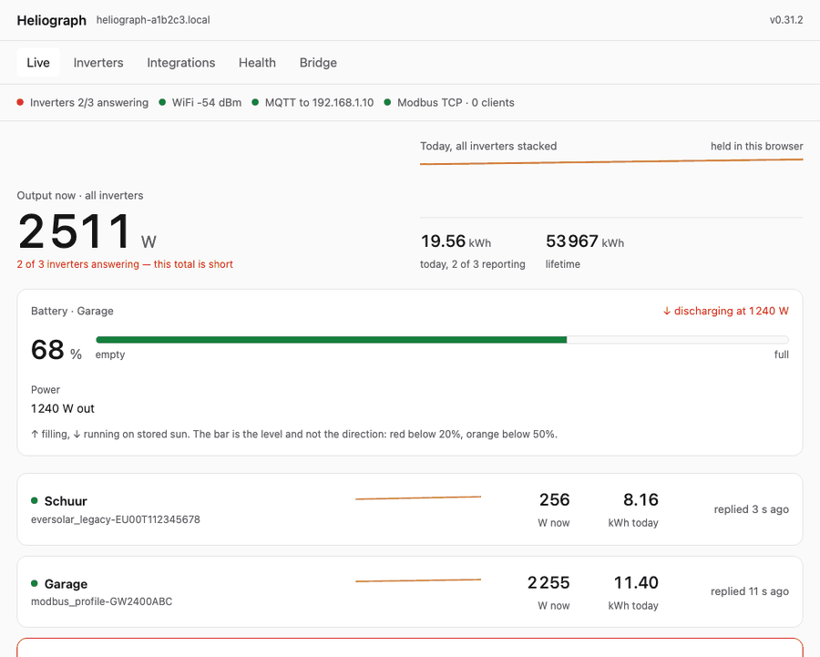
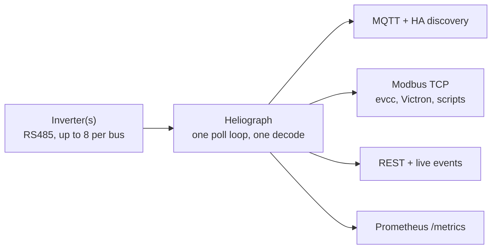
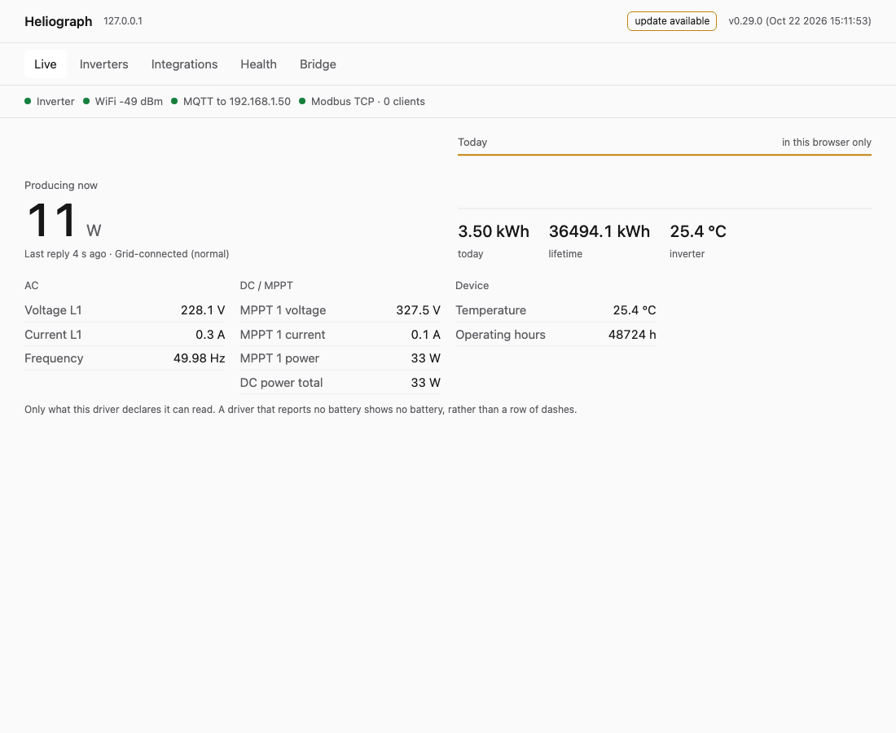
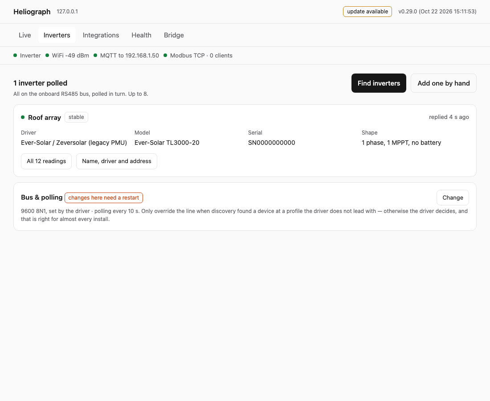
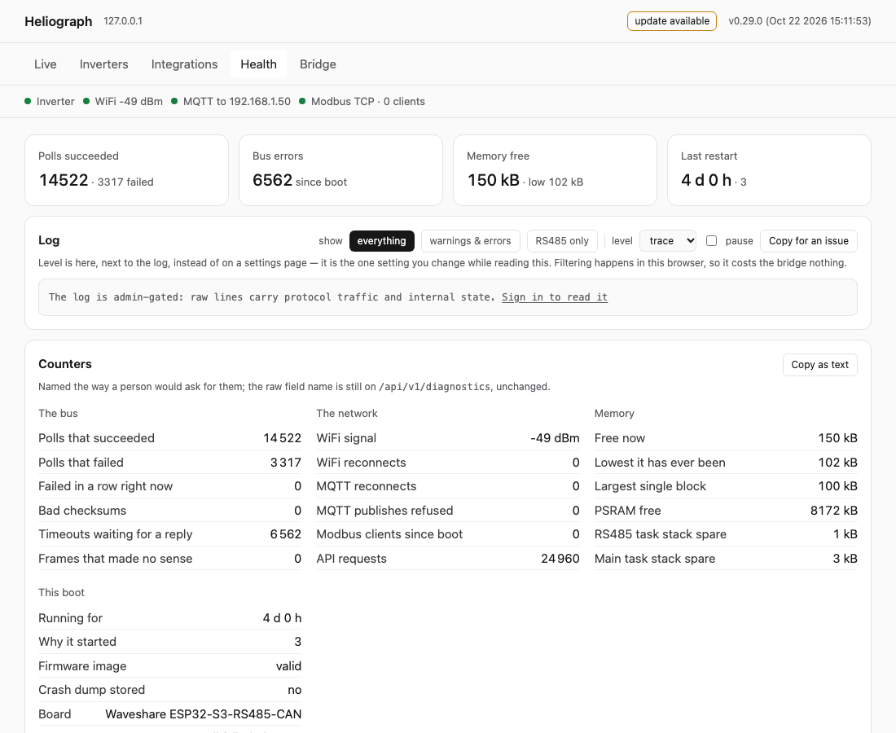

# Heliograph

### Your solar inverter on your own network. Over RS485: no cloud, no stick, no account.

Open-source firmware for a ~€25 ESP32-S3 board. It serves your inverter's data on your own
network as MQTT with Home Assistant discovery, Modbus TCP, REST and Prometheus.

<picture>
  <source media="(prefers-color-scheme: dark)" srcset="docs/images/tour-dark.gif">
  
</picture>

The dashboard runs on the board itself. Shown here with its built-in demo fleet: three inverters, one of them a hybrid with a battery.

**[Flash it from your browser →](https://timdebruijn.github.io/heliograph/)** · [Will it work with my inverter?](#will-it-work-with-my-inverter) · [Releases](https://github.com/Timdebruijn/heliograph/releases) · [Docs](docs/README.md)

> **Status:** pre-1.0, one maintainer. One inverter family is Stable today; the rest have a map and
> need a tester. Check [your inverter](#will-it-work-with-my-inverter) before you order a board.

**Built for** owners of an RS485 inverter whose portal died, whose Wi-Fi stick keeps dropping out,
or who simply want their data in Home Assistant, evcc or Grafana without a vendor in between.
**Not for** Hoymiles microinverters (use [OpenDTU](https://github.com/tbnobody/OpenDTU)),
Wi-Fi-only inverters, or anyone who needs plug-and-play support for their model today.

## Your inverter works fine. Everything around it doesn't.

- **Clouds close.** ZeverCloud is gone. SolarEdge retired its V1 cloud API on 3 November 2026.
  SolaX removed the local API on newer firmware.
- **Sticks are the weak link.** They drop out, fall back after a reboot, or get rate-limited.
  One Growatt owner: *"I have been banned for 24 hours."*
- **Your data has to live somewhere you control.** Negative-price hours in the Netherlands went
  85 → 316 → 458 → roughly 570 from 2022 to 2025
  ([Selectra](https://selectra.nl/energie/vergelijken/stroomprijs/negatieve-stroomprijs)), and
  *salderen* ends on 1 January 2027. Whatever you automate against that, you need your own numbers
  first.

An RS485 port does not need a vendor's permission. Three wires (A, B, GND) from the board to the
inverter, a browser tab to flash it, and the inverter is on your network.

## Why Heliograph

**It reads inverters the vendors gave up on.** The EverSolar/Zeversolar (AA55/PMU) protocol is
built in and **Stable**: the project exists because the author's EverSolar outlived its portal,
and it has run in production on the author's roof since. SolarMax (MaxTalk) and SunSpec are built
in as well, still Experimental.
[eversolar-protocol.md](docs/eversolar-protocol.md)

**A new Modbus inverter is a data file, not firmware.** Register maps are TOML, turned into code at
build time and validated in CI. 13 maps ship today. A tester whose three-phase Deye did not match the
bundled one wrote their own and got *"a pretty stable readout"*
([HA community thread](https://community.home-assistant.io/t/heliograph-esp32-firmware-that-speaks-your-inverters-native-protocol-mqtt-ha-modbus-tcp-rest-prometheus-looking-for-testers/1022820/3) ·
[adding-a-device.md](docs/adding-a-device.md)).

**Every output at once, from one decode.** The bridge is the only master on the RS485 bus, so
Home Assistant, evcc and Grafana all read at the same time without collisions.

**It tells you why the bus is silent.** The Health tab ranks likely causes (swapped A/B, duplicate
address, termination) with a one-click test for each, next to a register reader and a raw bus
capture with checksum verdicts.

**No toolchain, ever.** Browser flasher, captive-portal Wi-Fi setup, a discovery wizard that
proposes a driver, and over-the-air updates with a board check and SHA-256.

## Will it work with my inverter?

You need an inverter with an **RS485 port**.

| Inverter / protocol | Grade | Has a real device answered it? |
|---|---|---|
| EverSolar / Zeversolar **TL** | **Stable** | Yes. A TL3000-20 in production, the author's own |
| Zeversolar **TLC** | **Beta** | Yes. One TLC8000, on a contributor's hardware |
| Modbus maps: Deye (3), GoodWe ET, Growatt (SPH, MIN TL-X, MIC TL-X), Huawei SUN2000, Sofar (2), Solis (2), Sungrow SH | Experimental | Has a map, needs a tester. None of the 13 shipped maps has met a device yet |
| SunSpec (any inverter that implements it) | Experimental | No |
| SolarMax (MaxTalk) | Experimental | No |
| SolaX X1 | Experimental | One field attempt, zero bytes back |

Experimental means it may simply not work. Own one? Plug it in and report what happened: "nothing
came back" is as useful as "it works", and it is how an Experimental row becomes a Beta one.
Every map cites its sources row by row in [coverage.md](docs/drivers/coverage.md).

## Pick your board

Three Waveshare ESP32-S3 boards run the same firmware, and all three have the RS485 port.

| | | | |
|---|:---:|:---:|:---:|
| |  |  |  |
| **Board** | [ESP32-S3-RS485-CAN](https://www.waveshare.com/wiki/ESP32-S3-RS485-CAN) | [ESP32-S3-Relay-1CH](https://www.waveshare.com/wiki/ESP32-S3-Relay-1CH) | [ESP32-S3-Relay-6CH](https://www.waveshare.com/wiki/ESP32-S3-Relay-6CH) |
| **For** | Data only. The author's production bridge | Data + one DRM relay | Data + six relays, the full DRM0-8 set |
| **Price** | ~$19 | ~$18 | ~$29 |

Only want data? Take the RS485-CAN. Each board powers from USB-C or a 7-36 V DC terminal. Flash the
image that matches your board: on a 6CH the wrong one drives the buzzer. Pins, RTC battery and what has been verified on each:
[hardware.md](docs/hardware.md). Photos and prices are Waveshare's.

## Quick start

1. **Flash** the board from the **[web flasher](https://timdebruijn.github.io/heliograph/)** in Chrome or Edge.
2. **Join** the `Heliograph-Setup` Wi-Fi, pick your network, set an admin password.
3. **Wire A, B and GND** to the inverter's communication port ([rs485-bus.md](docs/rs485-bus.md):
   swapped A/B is the usual fix; never open the inverter's enclosure). Run the discovery wizard,
   add your MQTT broker, and Home Assistant picks it up.

Full walkthrough: [getting-started.md](docs/getting-started.md).

## What it serves

| Output | Details |
|---|---|
| **MQTT + Home Assistant** | Auto-discovery, one HA device per inverter. [mqtt.md](docs/mqtt.md) |
| **Modbus TCP** | Documented register map, one unit id per inverter, 39 of 44 channels. [modbus-register-map.md](docs/modbus-register-map.md) |
| **REST + live events** | JSON, a server-sent event stream, config backup and restore. [rest-api.md](docs/rest-api.md) |
| **Prometheus** | 53 metrics with a `device=` label; unknown is absent, not zero. [prometheus.md](docs/prometheus.md) |
| **Dashboard** | Live view, bus diagnostics, health counters, one-click firmware update. |

Polls every 10 s by default (1-3600 s). Up to 8 inverters can share one bus; so far that has run
against simulated fleets, not a real multi-inverter roof.

## Curtailment: hardware ready, not yet proven

With *salderen* ending and negative prices growing, "produce less" is a fair thing to want. Here is
exactly where Heliograph stands:

- **Exists:** the relay boards drive the DRM0-DRM8 lines (AS/NZS 4777) of an inverter's
  demand-response port. DRM0 means stop. A relay energised means DRM asserted, so a dead bridge
  leaves the inverter producing.
- **Not yet:** no relay has been wired to a real inverter's DRM port in the field, and no Modbus or
  SunSpec power setpoint reaches an inverter. There is no power-limit or zero-export feature to
  rely on.

Heliograph is the local actuator; the price logic belongs in Home Assistant, evcc or Node-RED, next
to your tariff. Wiring guide: [drm.md](docs/drm.md). A DRM port is part of the inverter's
grid-protection interface: have it wired by someone qualified.

## How it compares

| | Heliograph | Vendor cloud + stick | ha-solarman (Solarman sticks) | ESPHome Modbus YAML | Elfin EW11 / USR |
|---|---|---|---|---|---|
| Works without a cloud | Yes | No | Yes, while the stick cooperates | Yes | Yes |
| Adding an inverter | TOML map, browser flasher, OTA | n/a | Per definition file | Hand-written YAML | You write all the Modbus |
| Outputs | MQTT/HA, Modbus TCP, REST, Prometheus | Vendor app | Home Assistant | HA, MQTT | Raw RS485 over TCP |
| Legacy/EOL inverters | EverSolar, SolarMax | No | No | If you write it | If you write it |
| Proven on hardware | **Narrow** | Own brand | **Broad** | What you write | n/a |

Heliograph has met far fewer devices than the Home Assistant integrations. Its bet is different:
every output at once from one decode, protocols the vendors abandoned, and a local relay path on a
€25 board. [SolarAssistant](https://solar-assistant.io) is a mature, closed-source Raspberry Pi
appliance for hybrid and off-grid systems. evcc consumes Heliograph's data over Modbus TCP; it is
not a rival.

## Engineering you can check

- 1,081 host tests in 31 files, cppcheck, ruff, a layering gate and a tag-must-match-version gate on
  every release.
- A production bridge ran 16.4 days without a restart, and its free heap did not shrink
  ([decisions.md](docs/decisions.md)).
- Control is opt-in. By default the bridge only monitors: *Allow control* is off and refuses every
  command and relay move before a driver sees it, and each control path has its own switch on top.
  Finishing setup requires an admin password.

Host tests prove the code does what its author intended. They do not prove your inverter will answer.

<b>Where it stops</b>: the full list of limits

- **Local and monitoring-only by default, not "secure".** No authentication on Modbus TCP, REST reads or
  `/metrics`; admin auth is HTTP Basic over plain HTTP; OTA images are unsigned (SHA-256 checks
  integrity, not origin). Keep it on a network you trust: [security.md](docs/security.md).
- **None of the 13 Modbus maps, SunSpec or SolarMax has met a device.**
- **No control path has reached an inverter.** The Relay-6CH was measured for order, polarity,
  failsafe and boot state; the 1CH switches, but its polarity has not been put on a meter.
- **Discovering an EverSolar or SolaX transmits** (it assigns a bus address), so `read_only_mode`
  does not cover it.
- **Modbus TCP carries 39 of the 44 channels.** Battery power, current, temperature and both battery
  energy counters have no register yet.
- **Several inverters on one bus** has only run against simulated fleets and one production bridge
  with one inverter ([#82](https://github.com/Timdebruijn/heliograph/issues/82)).
- **One maintainer, pre-1.0.** Expect breaking changes.

<b>Screenshots from a real bridge</b>

## Documentation

| I want to... | Read |
|---|---|
| Set it up | [getting-started.md](docs/getting-started.md) · [hardware.md](docs/hardware.md) · [rs485-bus.md](docs/rs485-bus.md) |
| Connect my stack | [mqtt.md](docs/mqtt.md) · [rest-api.md](docs/rest-api.md) · [prometheus.md](docs/prometheus.md) · [modbus-register-map.md](docs/modbus-register-map.md) |
| Turn an inverter down | [drm.md](docs/drm.md) |
| Add my own inverter | [adding-a-device.md](docs/adding-a-device.md) · [drivers/coverage.md](docs/drivers/coverage.md) |

Everything else is in the [docs index](docs/README.md).

## Join in

The most useful contribution right now: plug your inverter in and tell us what happened. If
Heliograph is useful to you, a star helps the next person with an orphaned inverter find it.

## Licence

MIT. See [LICENSE](LICENSE), with third-party notices in [LICENSE-THIRD-PARTY.md](LICENSE-THIRD-PARTY.md).
