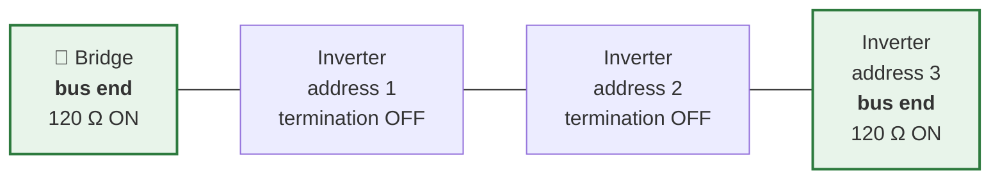

# Getting it working

The whole path, start to finish: what to buy, how to flash it, how to get it on your WiFi, how
to wire it to the inverter without touching anything dangerous, and how to make it find the
inverter once it is connected.

This used to live in the README. It moved here so the front page could stay a front page, and
because this is where you want it when you are standing at the inverter with a screwdriver.

If something does not answer, the [troubleshooting route](README.md#it-does-not-work) is the
faster way in than reading this top to bottom.

## Before you start: what you are getting into

**Read this properly. Heliograph is a do-it-yourself project.**

- You will be connecting two or three wires to your inverter's **communication port**. That
  is low-voltage data wiring — **not** mains, and **not** the DC side of your panels.
- Everything described here uses **external ports only**. You should never open the
  inverter's enclosure. If a guide ever tells you to, stop.
- Your inverter is still equipment connected to the grid. **If you are not comfortable
  working around it, ask a qualified installer.** There is no shame in that, and it is far
  cheaper than the alternative.
- Always follow **your inverter's own manual** for what its connector pins do. Pinouts differ
  between models and even between generations of the same model. Never assume.
- Interfering with a communication port can, on some models, affect warranty or the
  manufacturer's monitoring. Check before you commit.
- Heliograph is provided under the MIT licence: **no warranty, at your own risk**. With the
  settings it ships with it cannot act on your inverter at all: `security.read_only_mode` is
  on by default and refuses every command. That flag is the guarantee, not an absence of
  capability — see [docs/security.md](security.md).

---

## 1. Get the hardware

You need one ESP32-S3 board with an RS485 port. Pick based on whether you also want
curtailment:

| Board | Buy | Docs | What it adds | Status |
|---|---|---|---|---|
| **ESP32-S3-RS485-CAN** | [product page](https://www.waveshare.com/esp32-s3-rs485-can.htm) | [wiki](https://www.waveshare.com/wiki/ESP32-S3-RS485-CAN) | battery-backed clock; the reference board | **Production** — pick this if you only need to read the inverter |
| **ESP32-S3-Relay-1CH** | [product page](https://www.waveshare.com/esp32-s3-relay-1ch.htm) | [wiki](https://www.waveshare.com/wiki/ESP32-S3-Relay-1CH) | 1 relay (on/off curtailment), clock | **Hardware-verified** — boots and actuates its relay on real hardware 2026-07-26; polarity not yet meter-measured |
| **ESP32-S3-Relay-6CH** | [product page](https://www.waveshare.com/esp32-s3-relay-6ch.htm) | [wiki](https://www.waveshare.com/wiki/ESP32-S3-Relay-6CH) | 6 relays (stepped curtailment), status LED, buzzer | **Hardware-verified** — relays, polarity and failsafe measured 2026-07-23 |

All three are Waveshare boards and cost roughly €20–30. **If you only want to see what your
inverter is doing, take the first one.**

The relay boards are specifically for driving an inverter's **DRM input** — the
demand-response terminals, a dry contact. That is not the only way to turn an inverter down:
where the inverter accepts a power limit written over **RS485**, that path needs no relay
board at all, just the plain RS485-CAN board. Relays are the answer for inverters that expose
no writable limit, where a DRM contact is the only control path there is. Which of the two
applies is a property of your inverter, not of this firmware — the brand pages under
[docs/](README.md) say which.

Besides the board you need a **USB-C cable**, and wire for the RS485 connection: two data
conductors (**A** and **B**) plus a **ground** reference. A cut Ethernet patch cable is
often the easiest source, and for inverters with an RJ45 communication port it may be all
you need. The RS485-CAN and Relay-6CH can be powered either over USB-C or from a 7–36 V DC
screw terminal, which is handy when there is no USB power near the inverter; check the
product page for whichever board you buy.

For one inverter, A/B/GND is genuinely all there is to it.

**Several inverters share one cable.** They hang off it in a chain — not one cable each — and
each answers to its own address:



Three rules in one picture: **chain, not star**; the 120 Ω terminator goes at the **two ends
only**; and every unit needs its **own address** set before you connect them, or two inverters
answer at once and their replies collide. Read
**[docs/rs485-bus.md](rs485-bus.md)** before you wire it — including what a star topology
looks like and why it works on the bench and fails in the roof.

> **Several inverters on one bus are polled in turn**, up to eight, each with its own address.
> The first is configured under *Settings → Driver*, the rest under *Settings → Extra devices* —
> one row per inverter, each with its own driver and whatever that driver needs to address it.
> The page refuses to save a row with no driver, an unset register map, or an address already
> in use, because all three are mistakes the firmware can only report as a log line at boot.
> Save, then restart. Afterwards the **Device** tab lists every inverter that is actually being
> polled, and says so plainly when one of the configured ones is missing and why.
>
> Over the API it is one field, and sending the array **replaces** it:
>
> ```
> curl -u admin:PASSWORD -X PATCH http://<bridge>/api/v1/config \
>   -H 'Content-Type: application/json' \
>   -d '{"additional_devices":[{"driver_id":"modbus_profile","options":{"unit_id":"2"}}]}'
> ```
>
> **Extended discovery sweeps addresses 1–8**, so the wizard reports one candidate per inverter
> with the address each answered at — use it to check that the addresses you assigned actually
> took. It configures one device; the rest go in `additional_devices` as above. Quick discovery
> is unchanged: each driver's default address only.
>
> **Every output carries all of them now.** Modbus TCP serves one **unit id per inverter**,
> consecutively from `modbus.unit_id` — unit 1, 2, 3 with the default — and the register map is
> the same at each. Prometheus labels every inverter series with `device="…"`, the same id REST
> and Home Assistant use. Note that the units share one bus and one poll interval, so each is
> read roughly every N intervals with N inverters.

## 2. Flash the firmware

- **In your browser (easiest):** open the
  [web installer](https://timdebruijn.github.io/heliograph/) in Chrome or Edge, plug the
  board into your computer with USB-C, pick your board, click Connect. Nothing to install.
- **With esptool:** download `heliograph-<version>-<board>-factory.bin` from the
  [latest release](https://github.com/Timdebruijn/heliograph/releases/latest):

  ```bash
  esptool.py --chip esp32s3 write_flash 0x0 heliograph-<version>-<board>-factory.bin
  ```

- **From source:** `pio run -e waveshare-rs485-can` (or the environment for your board), then
  flash `.pio/build/waveshare-rs485-can/firmware.factory.bin`.

Already running Heliograph? Update over the air instead — *Settings → Firmware update* with
the release's `heliograph-<version>-<board>.bin`. **Settings survive an over-the-air update;
a factory flash erases them.**

## 3. Connect it to your WiFi

On first boot the board creates its own WiFi network called **`Heliograph-Setup-XXXX`**. Join
it with your phone or laptop; the setup page opens by itself. Choose your network, set an
admin password, and save. The board reboots and tells you the address to visit, something
like `http://heliograph-a1b2c3.local`.

**Write that admin password down.** The same setup network comes back on its own if the board
later loses WiFi for a few minutes — a router reboot is enough — so that you can point it at a
new network without digging the board out. Because that network is open and anyone in range
could otherwise reconfigure your bridge, changing anything through it asks for the admin
password once one is set.

If you lose the password, the way back in is a **factory reset**: hold the board's **BOOT**
button for about 5 seconds while it is running. That erases the stored configuration — WiFi,
password, everything — and returns the board to first-boot setup. Failing that, re-flash a
`-factory.bin` over USB, which wipes the same settings.

Two things worth knowing before you rely on it. On the Relay-6CH the countdown blinks the LED
and the buzzer confirms the wipe; **on the RS485-CAN there is no LED and no buzzer, so the hold
gives no feedback at all** — the board simply reboots into setup when it worked. And the reset
itself is only hardware-verified on the Relay-6CH; on the other two boards the pin comes from
the schematic and nobody has run it. Details and the download-mode caveat:
[docs/hardware.md](hardware.md#recovery--hold-boot-to-factory-reset).

## 4. Wire it to the inverter

> **If you have never wired anything before, this is the step to slow down on.** It is three
> wires and no mains voltage, but *where* those three wires go differs on every inverter.
> Nothing below replaces your own inverter's manual.

**First, find the port — in your manual, not by looking.** Inverters put RS485 in very
different places, and the plug tells you nothing:

- an **RJ45 socket** that looks exactly like a network port (but is not one — do not plug it
  into your router)
- a **screw terminal** block, often behind a small cover
- a **multi-pin plug** with a locking ring (a Solis S6 hybrid uses a 16-pin COM connector)

In the manual, look for **RS485**, **COM**, **Modbus**, **Meter** or **BMS**. The manual is
also the only place that tells you *which pin is which* — pinouts differ between models, and
between generations of the same model. Do not copy a pinout you found for a similar-looking
inverter.

**Check whether the port is already taken.** Many inverters ship with a WiFi or LAN stick from
the manufacturer, and on some models that stick sits on the same RS485 line. If so you have to
choose: the vendor's app, or your own reading. Your manual, or the brand page under
[docs/](README.md), will say which port is which.

**Then connect**, with the inverter's manual in front of you:

- board **A** → inverter **A** (sometimes labelled D+)
- board **B** → inverter **B** (sometimes labelled D−)
- board **GND** → inverter **GND**

Connect the ground. It is not optional folklore: without a shared reference the bus can stay
completely silent no matter how the data wires are arranged. And if nothing comes through at
first, **swapping A and B is the single most common fix** — it cannot damage anything.

Two reassurances, because this is the step people hesitate on. These are **signal** wires,
carrying a few volts; the dangerous parts of an inverter are behind its cover, and you never
open that. And plugging it in cannot change a setting on your inverter: the shipped
configuration has `security.read_only_mode` on, which refuses every command before it can reach
a driver.

If you want the longer version — cable choice, chaining several inverters, where the 120 Ω
terminators go — read [docs/rs485-bus.md](rs485-bus.md) **before** you buy cable.

## 5. Find your inverter

Open the dashboard and run the wizard on the *Discovery* tab. It tries the supported
protocols and proposes a driver. It identifies the **protocol**, not the model — so a driver
that ships several register maps still needs the map chosen, and the wizard's confirm step
asks for it.

The wizard offers two modes. **Quick** tries each driver at its own default address, which is
what you want for one inverter. **Extended** additionally sweeps addresses 1–8, which is slower
and is how you check that the addresses you assigned to several inverters actually took.

**If nothing answers**, work down this list — the first two fix most cases:

1. **Swap A and B.** It cannot damage anything, and reversed data wires are the single most
   common cause of complete silence.
2. **Check the ground wire is connected.** Without a shared reference the bus can stay silent
   however the data wires are arranged.
3. **Unplug the manufacturer's dongle** if one is on that port. Two masters on one bus corrupt
   each other's messages, and the dongle will not yield.
4. **Try the other baud rate.** Most inverters ship at 9600; some at 115200. Discovery tries
   both, but a device configured to something else answers neither.
5. **Check the unit id.** Most vendors ship 1 — GoodWe ships this family at **247**, and a
   wrong address looks exactly like a wiring fault. Extended discovery finds it for you.
6. **Then turn the log level up to `trace`** under *Settings* and watch the *Logs* tab. It
   shows exactly what is being sent and whether anything comes back, which separates "my wiring
   is wrong" from "it replied and we could not read it" — a distinction worth having before you
   open an issue.

<p align="center">
  
  <br>
  <em>Discovery is a guided wizard: it probes the bus, proposes a driver, and lets you confirm with a test poll before anything is saved.</em>
</p>

## 6. Connect your tooling

MQTT and Home Assistant discovery are configured under *Settings*; enable MQTT, point it at
your broker, and the entities appear in Home Assistant by themselves. Modbus TCP listens on
port 502, Prometheus scrapes `/metrics`, and the JSON API lives under `/api/v1/`.

---


## Curtailment: turning the inverter down

The relay boards can drive an inverter's **DRM input** (the demand-response terminals many
inverters carry) to reduce or stop production — useful during negative electricity prices or
under a feed-in limit. This matters most for the inverters Heliograph can only read: if there
is no way to write a power limit over RS485, a DRM contact may be the only control path that
exists.

Three things are worth understanding before you consider it:

**Status: the actuator is proven, the connection to an inverter is not yet.** On the Relay-6CH
the relays themselves have been verified on real hardware (2026-07-23): channel order,
polarity, the power-cut failsafe and the de-energised boot state were all measured rather than
assumed. The Relay-1CH's single relay has since been actuated on hardware too (2026-07-26),
though its polarity and failsafe have not yet been meter-measured the way the 6CH's were. What
has *not* happened yet on either board is driving a real inverter's DRM port — that step is
waiting on a manufacturer's confirmation of how their terminals expect to be driven. Treat this
as a capability that is built and bench-tested, not as one that has been run in the field.

**It ships switched off.** Two independent settings must both be changed before a relay can
move (`relays.enabled` on, and `security.read_only_mode` off). A relay board with factory
settings is inert.

**Failing safe is a wiring decision.** A de-energised relay leaves its NO contact open and its
NC contact closed. Whichever way round your inverter expects its DRM input, one of those two
contacts keeps the rule *"if the bridge dies, the inverter keeps producing"* true — without
changing any firmware setting. On the 6CH this was measured, not assumed: cutting power
releases the contact immediately, and the board boots with every relay de-energised. No relay
state is stored anywhere, deliberately, so a reboot can never restore a curtailment nobody
just asked for.

Full wiring rules and a pre-flight checklist: **[docs/drm.md](drm.md)**. Check your own
inverter's manual for what its DRM terminals expect — this varies by manufacturer and must
never be guessed.

---


## Help support your own inverter

If your inverter is not in the table, you are exactly the person this project needs. There
are three ways to help, and only one of them involves writing code:

1. **Tell us it exists.** Open a
   [device request](https://github.com/Timdebruijn/heliograph/issues/new/choose) with the
   model and whatever documentation you have. Sometimes the protocol is already known.
2. **Add a Modbus inverter yourself — as a data file.** Modbus devices are described by a
   TOML file listing registers and scaling, not by C++. If you can read a register table in a
   manual, you can write one.
   [docs/adding-a-device.md](adding-a-device.md) walks through it, including a script
   for probing a device you have in front of you.
3. **Confirm an Experimental driver.** The Growatt SPH and SolaX X1 drivers are implemented
   but unproven on real hardware. If you own one, running it and reporting what happened —
   including "it returned nothing" — is genuinely valuable. That is how the SolaX findings
   already in the docs came to be.

See [CONTRIBUTING.md](../CONTRIBUTING.md) for the practicalities.

---

